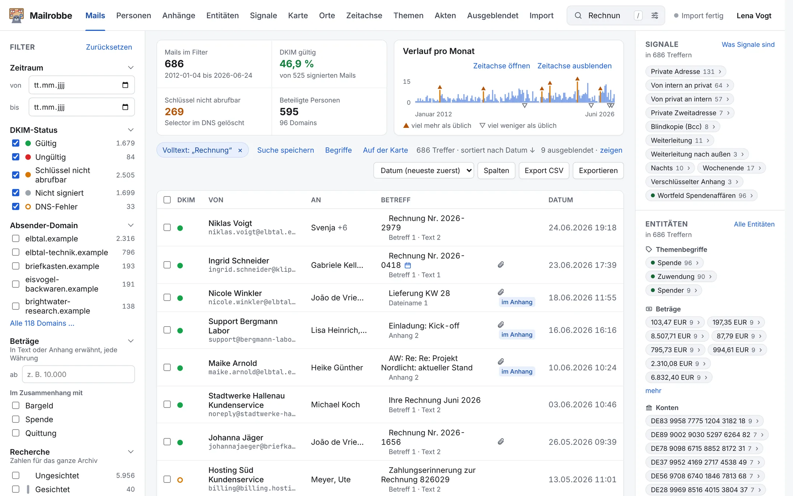
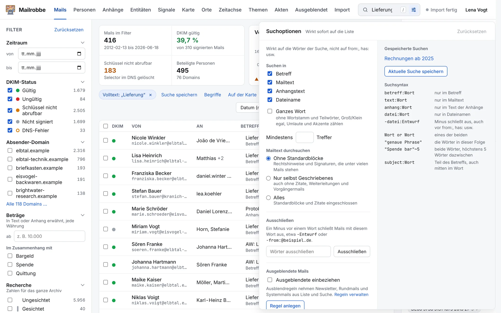
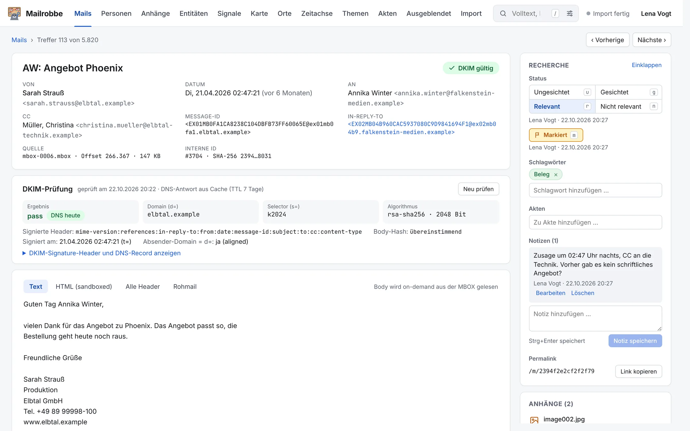
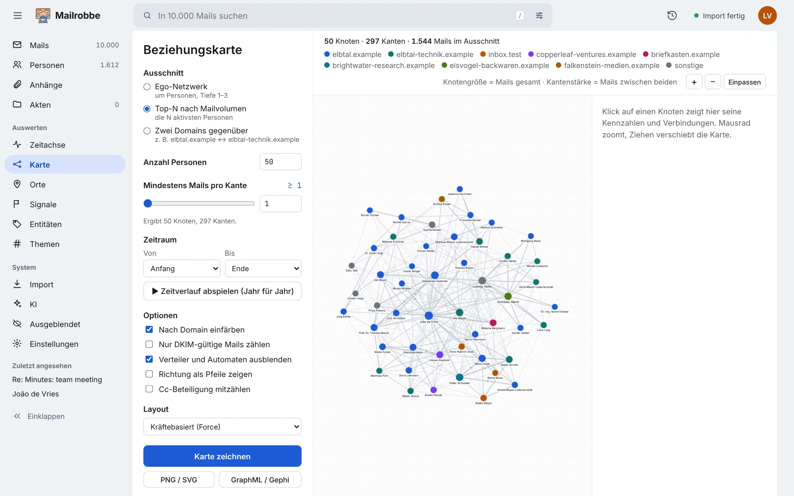
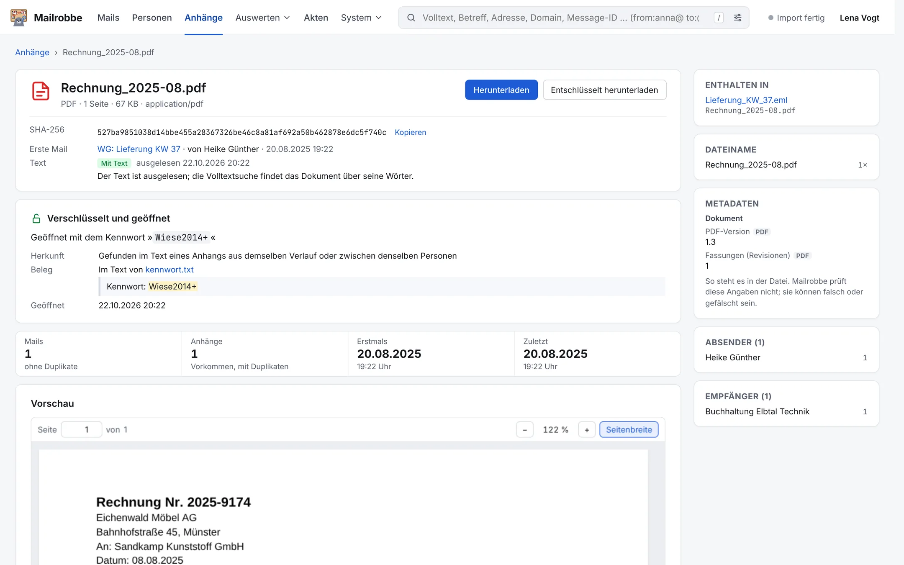

<div align="center">

<picture>
  <source media="(prefers-color-scheme: dark)" srcset="./docs/logo/logo-wordmark-dark.svg">
  
</picture>

<h1>Mailrobbe</h1>

**Mail-Leaks und große Mailarchive recherchieren: durchsuchen, prüfen, belegen.**

[](https://github.com/sponsors/admonstrator) [](https://buymeacoffee.com/admon) [](https://paypal.me/aaronviehl) [](https://ko-fi.com/admon)

Von admon, mit Hartnäckigkeit und zu viel Energydrink. Keine Firma dahinter — wenn es deiner Recherche geholfen hat, freut sich die Weiterentwicklung über Unterstützung.

Fragen, Lob, Kritik: [hey@admon.me](mailto:hey@admon.me), auf Wunsch verschlüsselt mit [diesem PGP-Schlüssel](https://github.com/admonstrator/Admonstrator/blob/main/pgp/hey@admon.me.asc).

<sub>Fingerabdruck `C2D7 EB96 8E27 4D5F 1B24  1B04 95E1 6BDE A94F 50A4`</sub>

[Website](https://mailrobbe.admon.me/) | [Für wen](#für-wen) | [Auf einen Blick](#auf-einen-blick) | [Was Mailrobbe kann](#was-mailrobbe-kann) | [Schnellstart](#schnellstart) | [Häufige Fragen](#häufige-fragen)

</div>

---

Mailrobbe macht Mail-Leaks und große MBOX-Archive durchsuchbar, die niemand von vorn bis hinten lesen kann — auch in Anhängen. Es prüft per DKIM, welche Mails nachweislich unverändert sind, zeigt wer mit wem wann worüber geschrieben hat, und öffnet verschlüsselte Anhänge mit Kennwörtern, die im Archiv selbst stehen.

Alles läuft lokal im Browser, ohne Cloud, ohne Konto. Die Originaldateien bleiben unverändert, jede Fundstelle führt zurück zur Quelle. Bewertet wird nichts — das macht die Redaktion.



<sub>Alle Bilder hier und auf der [Website](https://mailrobbe.admon.me/) zeigen ein erfundenes Testarchiv, keine echten Mails.</sub>

---

## Für wen

- **Leaks und Postfach-Exporte** — zu groß zum Durchlesen, oft mit Anhängen und Kennwörtern.
- **Zitieren mit Beleg** — DKIM-Prüfung vorab, Export mit Originalmails und Prüfsummen für Anwälte.
- **Personen und Netzwerke** — wer mit wem, wer wusste was, wer steckt hinter welcher Adresse.
- **Teams** — gemeinsam sichten und markieren, ohne Material in eine Cloud zu laden.

Fürs eigene Postfach ist das zu viel Werkzeug. Dafür reicht das Mailprogramm.

---

## Auf einen Blick

| Frage | Wo in Mailrobbe |
| --- | --- |
| Wo steht ein Begriff, auch in PDFs, Tabellen und ZIP-Dateien? | Suchfeld + Suchmenü |
| Ist diese Mail echt und unverändert? | DKIM-Siegel im Mail-Detail, Filter nach DKIM-Status |
| Wer hat mit wem wie oft geschrieben? | Auswerten › Karte |
| Wer steckt hinter mehreren Adressen? | Alias-Vorschläge unter Personen |
| Wer wusste was wann? | Auswerten › Zeitachse |
| Worüber wurde wann auffällig viel geschrieben? | Auswerten › Themen |
| Welche Mails lese ich zuerst? | Auswerten › Signale, Akten |
| Newsletter und Systemmails los werden? | System › Ausgeblendet |
| Was steht in einem verschlüsselten Anhang? | Anhänge, Filter „Verschlüsselt" |
| Scans, Fotos von Dokumenten, Sprachnachrichten durchsuchen? | „Text erkennen" / „Transkribieren", System › KI |
| Worum geht's, ohne alles zu lesen? | „Zusammenfassen" an Mail, Dokument, Akte |
| Welche Beträge, Konten, Namen tauchen auf? | Auswerten › Entitäten |
| Wo wurden Fotos gemacht? | Auswerten › Orte |
| Funde im Team festhalten? | Prüfstatus, Notizen, Schlagworte, Akten |
| Belege an Anwälte? | Export als ZIP |
| Mail für Artikel oder Social Media? | Aktionen › „Als Bild für Soziale Medien" |

---

## Was Mailrobbe kann

**Suchen, auch in Anhängen.** Volltextsuche über Betreff, Mailtext, Anhänge (PDFs, Office, ZIP) und Dateinamen, mit Wortformen. Jede Trefferzeile zeigt, wo und wie oft. Das Suchmenü grenzt ein: nur Betreff, ganzes Wort, Mindesttrefferzahl, ohne Zitate und Signaturen.



**Lesen ohne Ballast.** Mail-Ansicht wie im Mailprogramm. Zitate, Weiterleitungen und Signaturen eingeklappt, Fundstellen markiert. Text, HTML, Header und Rohmail live aus der Originaldatei, HTML-Mails abgeschottet. Kalendereinladungen inklusive Antworten.

**Newsletter raus.** Ausblendregeln nach Absender, Domain, Verteiler oder Betreff — mit Vorschlägen. Wiederkehrende Signaturen und Rechtstexte fliegen aus der Suche, Fast-Duplikate werden zusammengefasst.

**Echtheit prüfen, nicht vermuten.** Jede DKIM-Signatur einzeln geprüft und dokumentiert. Schlüssel nicht mehr im DNS? Mailrobbe sucht ihn: im Archiv selbst, im Schlüsselarchiv ZK Email, rechnerisch aus zwei Signaturen.



**Personen statt Adressen.** Profile mit Kontakten, Aktivität je Jahr, auffälligen Begriffen. Alias-Vorschläge, nie automatisch zusammengeführt, jede Zusammenführung rückgängig. Klarnamen überall sichtbar, auch auf der Karte.

**Netzwerke und Zeitverlauf.** Beziehungskarte nach Person, Zeitraum oder Domain, Klick auf eine Verbindung öffnet die Mails, GraphML für Gephi. Zeitachse mit Ausreißern, Verstummen und erster Erwähnung. „Themen" zeigt Begriffe, die auffällig häufig vorkommen.



**Wo das Lesen anfängt.** Signale markieren mögliche Fundstellen nach nachlesbaren Regeln — private Adressen, BCC, Weiterleitungen nach außen, Nachtmails, Recherchebegriffe. Kein Beweis, aber ein Anfang. Entitäten (Beträge, IBANs, Orte, Telefonnummern) filtern mit einem Klick, Akten liefern sechs Recherchethemen mit 18 fertigen Suchen.

**Anhänge und verschlüsselte Dateien.** Jedes Dokument einmal gelistet, mit Herkunft. PDF, Office, Bild, Audio, Video direkt im Browser samt Metadaten. Gefundene Kennwörter probiert Mailrobbe automatisch an verschlüsselten Dateien — geraten wird nicht.



**KI, lokal.** Texterkennung und Transkription laufen im Container auf dem eigenen Rechner. „Zusammenfassen" liefert KI-Schlagwörter und Recherchehinweise mit Zitatpflicht aus dem Text. Externe KI-Dienste nur nach ausdrücklicher Freigabe, mit Obergrenze und Protokoll jeder Anfrage.

**Orte.** GPS aus Fotos, Orte aus Texten und Terminen auf einer eingebauten Karte ohne Internet. Detailkarte mit Straßen auf Knopfdruck.

**Team und Weitergabe.** Prüfstatus, Notizen, Schlagworte und Akten gemeinsam für alle, die mit demselben Mailrobbe arbeiten. Export als ZIP mit Originalmails, PDFs und Prüfsummen für Anwälte. „Als Bild für Soziale Medien" schwärzt Beteiligte, Adressen und Namen automatisch — auch bei Transkripten.

Mehr Bilder auf der [Website](https://mailrobbe.admon.me/).

---

## Bevor es losgeht

**Die Mails sind heilig. Die Rechercheakte auch.**

MBOX-Dateien werden nur lesend eingebunden, keine Mail wird verändert. Notizen, Schlagworte, Akten und Zusammenführungen liegen im Docker-Volume `mailrobbe_pgdata`.

> Sichere dieses Volume, bevor du größere Dinge tust, und benutze nie `docker compose down -v`. Das löscht die Rechercheakte, ohne Rückfrage und ohne Mitleid.

---

## Schnellstart

Nötig: Docker (Docker Desktop unter macOS/Windows, Docker Engine unter Linux) und git, mit etwa 10 GB RAM für Datenbank und Import zusammen.

```sh
git clone https://github.com/admonstrator/mailrobbe.git
cd mailrobbe
echo "MAILROBBE_MBOX_HOST_DIR=/Volumes/Archiv/mbox" > .env   # Ordner mit den MBOX-Dateien
docker compose up -d --build
```

**Windows:** Befehle in einem WSL-Terminal (`wsl --install`), Distribution in Docker Desktop unter Settings › Resources › WSL Integration aktivieren. Laufwerk D: heißt in WSL `/mnt/d/...`; schneller liest der Import, wenn die MBOX-Dateien direkt im WSL-Dateisystem liegen, etwa `~/mbox`.

1. **Einlesen.** http://127.0.0.1:8000/import öffnen, „Import starten" klicken. Pausieren und fortsetzen jederzeit möglich.
2. **Aufräumen.** System › Ausgeblendet für Newsletter/Systemmails, bei Personen die sicheren Alias-Vorschläge zusammenführen.
3. **Einsteigen.** Akten › Themen für Wortfelder und fertige Suchen; Signale, Themen, Entitäten unter Auswerten; KI unter System.
4. **Festhalten.** Eigenen Namen eintragen, dann Prüfstatus, Notizen, Schlagworte, Akten vergeben — einzeln oder für eine ganze Suche.

### Aktualisieren

```sh
git pull
docker compose down
docker compose up -d --build
```

Danach „Import starten" klicken. Mails werden nicht neu eingelesen, Notizen und Akten bleiben.

### Einstellungen

Die meisten Einstellungen stehen unter **System › Einstellungen**: Domains, Zeitzone, KI-Modelle, DKIM, Detailkarte und mehr — wirkt sofort bzw. ab dem nächsten Import. Was davor gebraucht wird, bleibt in der `.env` neben `docker-compose.yml`:

| Wert | Wofür |
| --- | --- |
| `MAILROBBE_MBOX_HOST_DIR` | Ordner mit den MBOX-Dateien (Voreinstellung `./data/mbox`) |
| `MAILROBBE_BASIC_AUTH_USER`/`_PASSWORD` | Zugangsschutz; ohne beide ist die Oberfläche offen |
| `MAILROBBE_AI_ALLOW_REMOTE` | `true` erlaubt KI-Dienste außerhalb des eigenen Netzes |
| `MAILROBBE_MAP_HOST_DIR` | Ordner für die Detailkarte (bis 10 GB) außerhalb von Docker |
| `MAILROBBE_PORT` | Port der Oberfläche (Voreinstellung 8000) |

Recherchethemen, Wortfelder und Signalregeln stehen in [`src/mailrobbe/themes.toml`](src/mailrobbe/themes.toml); alle übrigen Einstellungen in [`src/mailrobbe/config.py`](src/mailrobbe/config.py).

---

## Suchen

| Eingabe | findet |
| --- | --- |
| `Spende` | das Wort und seine Formen in Betreff, Text und Anhängen |
| `Spende Quittung` | Mails mit beiden Wörtern |
| `Rat or Räte` | Mails mit einem der beiden |
| `"genaue Phrase"` | die Wörter in dieser Folge |
| `"Spende bar"~5` | beide Wörter, höchstens fünf dazwischen |
| `-Entwurf` | ohne dieses Wort, auch vor Operatoren (`-from:anna`) |
| `betreff:` `text:` `anhang:` `datei:` | nur in diesem Teil |
| `from:anna@` `to:@beispiel.de` `cc:keller` | Absender, Empfänger, Kopie |
| `domain:beispiel.de` | Mails mit dieser Domain beteiligt |
| `has:attachment` | nur Mails mit Anhang |
| `after:2024-01-01` `before:2025-01-01` | Zeitraum |
| `dkim:pass` `dkim:fail` | nach DKIM-Ergebnis |
| `<message-id@host>` | genau diese Mail |

Das Suchmenü stellt zusätzlich ein: Suchbereich, ganzes Wort, Mindesttrefferzahl, Umgang mit Zitaten/Standardblöcken, Ausschlüsse, ausgeblendete Mails einbeziehen — plus gespeicherte Suchen. Suche und Filter stehen in der Adresszeile, ein Link lässt sich also teilen.

---

## Häufige Fragen

**Verändert Mailrobbe meine Mails?** Nein. MBOX-Dateien sind schreibgeschützt, die Datenbank hält nur Metadaten und Suchindex. Jeder Abruf liest frisch aus der Datei und prüft gegen die Prüfsumme vom Import.

**Geht da etwas ins Internet?** Von selbst nur DKIM-Abfragen im DNS. Auf Knopfdruck: Schlüsselarchiv, Detailkarte, einmalig das Transkriptions-Modell (~670 MB von Hugging Face). Archivinhalte verlassen den Rechner nur, wenn ausdrücklich ein externer KI-Dienst erlaubt wird. Offline importieren: `MAILROBBE_DKIM_OFFLINE=1`, später mit `mailrobbe dkim` nachprüfen.

**Liest da eine KI meine Mails?** Nur was man auswählt. Texterkennung und Transkription laufen im Container, Zusammenfassungen nur über einen selbst eingerichteten Dienst. Maschinelles ist immer gekennzeichnet, mit Modell und Datum.

**Beweist „DKIM gültig", wer die Mail geschrieben hat?** Nein — nur, dass sie mit dem Schlüssel der Domain unterschrieben und seither unverändert ist. „Schlüssel nicht abrufbar" heißt nur: heute nicht mehr im DNS. Über eine Fälschung sagt das nichts.

**Warum fehlt eine Mail in der Liste?** Vermutlich eine Ausblendregel. „Ausgeblendete einbeziehen" im Suchmenü holt sie zurück, das Mail-Detail nennt die Regel.

**Was passiert mit gefundenen Kennwörtern?** Sie stehen im Klartext auf der Dokumentseite, mit der Mail, in der sie standen — sie sind selbst ein Beleg. Entschlüsselte Dateien werden nie gespeichert.

**Läuft das unter Windows?** Ja, mit Docker Desktop und WSL 2. Siehe [Schnellstart](#schnellstart).

**Mehrere Leute gleichzeitig?** Ja, alle sehen dieselbe Rechercheakte. Keine Konten, nur ein Name pro Browser — Zuordnung, kein Zugriffsschutz. Für echten Schutz: Benutzername/Kennwort aus den [Einstellungen](#einstellungen).

**Ist das mit KI gebaut?** Kurz: ja. Lang: mit viel KI-Unterstützung, aber von jemandem gelenkt, der es selbst benutzt. Über 4.000 automatische Tests, über 200 begründete Entscheidungen in [docs/DECISIONS.md](docs/DECISIONS.md).

**Fehler gefunden?** [Issue](https://github.com/admonstrator/mailrobbe/issues) aufmachen, ohne echte Mails im Anhang. Mit echtem Material: verschlüsselt an [hey@admon.me](mailto:hey@admon.me). Pull Requests willkommen.

---

## Lizenz und Preis

Mailrobbe steht unter der [GNU Affero General Public License 3.0](LICENSE). Du darfst es frei nutzen, ändern und weitergeben, auch in Redaktionen, Firmen und Behörden. Wer es verändert und anderen zur Verfügung stellt, auch über ein Netzwerk, muss seine Änderungen unter derselben Lizenz offenlegen.

Der Preis ist deine Entscheidung. Wenn Mailrobbe dir Zeit spart, freut sich die Weiterentwicklung über einen Betrag in einer Höhe, die dir angemessen erscheint. Das gilt für Einzelpersonen, Redaktionen und ausdrücklich auch für Behörden. Die Lizenzen der verwendeten Bausteine stehen in [THIRD-PARTY-NOTICES.md](THIRD-PARTY-NOTICES.md).

---

## Haftungsausschluss

Mailrobbe wird so bereitgestellt, wie es ist, ohne jede Gewähr. Benutzung auf eigene Verantwortung.

Es kann: deinen Rechner eine Nacht beschäftigen, dir Mails zeigen, die du lieber nicht gelesen hättest (dafür ist es gebaut), dich tagelang in eine Recherche ziehen.

Es kann nicht: entscheiden, ob etwas wahr, wichtig oder strafbar ist. Das bleibt bei Menschen mit Recherche-Erfahrung und guter Rechtsabteilung.

---

<div align="center">

**Mailrobbe wurde mit KI-Unterstützung und vielen Energydrinks von [admon](https://admon.me) entwickelt.**

Wenn es dir nützt, freut sich das Repository über einen Stern oder eine kleine Spende, um die Energydrinks zu finanzieren.

</div>
