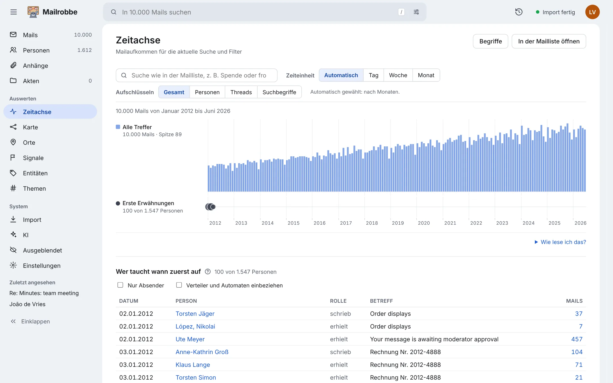

<div align="center">

<picture>
  <source media="(prefers-color-scheme: dark)" srcset="./docs/logo/logo-wordmark-dark.svg">
  
</picture>

<h1>Mailrobbe</h1>

**Große Mailarchive recherchieren. Spuren finden. Belege sichern.**

Für Journalistinnen und Journalisten, Redaktionen und Rechercheteams.
Lokal betrieben, für Archive mit Hunderttausenden Mails.

[Website](https://mailrobbe.admon.me/) · [Funktionen](#funktionen) · [Schnellstart](#schnellstart) · [Datenschutz](#daten--datenschutz) · [Dokumentation](#dokumentation)

</div>

---

Ein Leak oder Postfach-Export kann Hunderttausende Mails, Anhänge und Jahre an Kommunikation umfassen. Mailrobbe macht solche MBOX-Archive durchsuchbar und hilft, die nächste relevante Spur zu finden: in Mailtexten und Dokumenten, in Personenbeziehungen und im zeitlichen Verlauf.

Die Originaldateien bleiben unverändert. Jede Fundstelle führt zur Quelle zurück. Mailrobbe sortiert und zeigt Zusammenhänge – journalistisch bewerten muss sie ein Mensch.

<p align="center">
  <a href="site/img/mailliste.webp"></a>
</p>
<p align="center"><sub>Die Abbildungen zeigen ausschließlich synthetische Testdaten.</sub></p>

## Auf einen Blick

- **Finden:** Volltextsuche in Mails, Anhängen und Archiven; Filter, Suchsyntax und Fundstellen.
- **Prüfen:** DKIM-Signaturen, Originalmail und technische Details einer Fundstelle.
- **Einordnen:** Personen, Alias-Adressen, Kommunikationsnetzwerke und Zeitverläufe.
- **Auswerten:** Themen, Recherche-Signale, Entitäten, Orte und Kalendertermine.
- **Zusammenarbeiten:** Prüfstatus, Notizen, Schlagworte, Akten und gespeicherte Suchen.
- **Lokal arbeiten:** Betrieb auf dem eigenen Rechner; kein Cloud-Konto erforderlich.

## Funktionen

### Suchen und lesen

Durchsuche Betreff, Mailtext, Dateinamen und extrahierte Texte aus Anhängen – auch aus PDFs, Office-Dokumenten und gepackten Archiven. Das Suchmenü grenzt den Bereich ein; Operatoren wie `from:`, `subject:`, `after:` und `dkim:` verfeinern die Suche. Treffer zeigen, wo Suchbegriffe vorkommen.

Die Mailliste bietet Filter, Zähler, CSV-Export und serverseitige Seitennavigation. Im Mail-Detail lassen sich Text, HTML, Header und Rohmail anzeigen. Zitate, Weiterleitungen und Signaturen können eingeklappt werden; Kalendereinladungen erscheinen mit Antworten und Termindaten.

### Echtheit und Herkunft prüfen

Mailrobbe prüft DKIM-Signaturen und dokumentiert Ergebnis, Prüfgrund und technische Details. Fehlende DNS-Schlüssel bedeuten nicht automatisch, dass eine Mail gefälscht ist. Für gelöschte Selektoren kann Mailrobbe auf ausdrücklichen Start hin nach Schlüsseln suchen.

Mails werden bei Bedarf erneut aus der schreibgeschützt eingebundenen MBOX-Datei gelesen und mit der beim Import gespeicherten Prüfsumme abgeglichen. Anhänge und Dokumente lassen sich mit ihrer Herkunft aus den Mails nachvollziehen.

### Personen und Kommunikation verstehen

Personenprofile bündeln Adressen, Kontakte, Aktivität und häufige Begriffe. Mailrobbe schlägt mögliche Alias-Adressen vor; zusammengeführt wird erst nach einer bewussten Entscheidung und Zusammenführungen lassen sich rückgängig machen.

Die Beziehungskarte zeigt Kommunikationswege nach Person, Zeitraum oder Domain. Ein Klick auf eine Verbindung führt zu den betreffenden Mails. Die Zeitachse macht Veränderungen, auffällige Aktivität und erste Erwähnungen sichtbar; Themen zeigen Begriffe, die in einem Zeitraum oder einer Auswahl besonders häufig auftreten.

<table>
  <tr>
    <td width="50%"><a href="site/img/karte.webp"></a></td>
    <td width="50%"><a href="site/img/zeitachse.webp"></a></td>
  </tr>
</table>

### Recherche-Einstiege und Anhänge

- **Signale** weisen nach nachvollziehbaren Regeln auf mögliche Rechercheansätze hin – sie sind keine Beweise.
- **Entitäten** erschließen unter anderem Beträge, Konten, Organisationen, Personen, Orte und Telefonnummern.
- **Orte** verbinden GPS-Daten von Fotos mit Orten in Texten und Terminen; eine eingebaute Übersichtskarte funktioniert ohne Internet.
- **Dokumente** lassen sich als eigene Liste recherchieren, in unterstützten Formaten im Browser ansehen und nach Metadaten durchsuchen.
- **Verschlüsselte Anhänge** können mit Kennwörtern geöffnet werden, die Mailrobbe im Archiv gefunden hat. Ein konkret bekanntes Kennwort kann auch manuell eingegeben werden.
- **Ähnliche Mails**, Newsletter und wiederkehrende Standardblöcke lassen sich erkennen und beim Sichten ausblenden.

### KI – gezielt und nachvollziehbar

Optional lassen sich Scans per Texterkennung auslesen, Audio und Video transkribieren sowie Mails, Dokumente und Akten zusammenfassen. Aufgaben werden gezielt für eine Datei oder Auswahl gestartet, nicht ungefragt für das ganze Archiv. Maschinell erzeugte Ergebnisse sind gekennzeichnet; Hinweise auf Recherchethemen benötigen Textbelege.

Die Verarbeitung kann lokal eingerichtet werden. Dienste außerhalb des eigenen Rechners oder Netzwerks sind standardmäßig nicht erlaubt und müssen ausdrücklich konfiguriert werden. KI-Ergebnisse sind Arbeitshilfen, keine Tatsachenfeststellungen.

### Teamarbeit und Weitergabe

Prüfstatus, Markierungen, Notizen, Schlagworte und Akten teilen sich alle, die dieselbe Installation nutzen. Gespeicherte Suchen und Permalinks helfen, Recherchewege festzuhalten. Ausblendregeln können Newsletter und Systemmails aus der Sichtung nehmen, ohne sie aus dem Archiv zu löschen.

Für die Weitergabe gibt es Exporte mit Originalmails, PDFs, Manifest und Prüfsummen sowie CSV-, EML- und GraphML-Ausgaben. Für Veröffentlichungen kann Mailrobbe Mail- und Transkriptbilder mit vor dem Zeichnen geschwärzten Inhalten erstellen.

### Import und Betrieb

Das Import-Dashboard zeigt Dateien, Fortschritt, Durchsatz und Fehler. Läufe lassen sich pausieren und fortsetzen; DKIM-Prüfungen können separat gestartet werden. Einstellungen für Import, Recherche und optionale KI-Dienste gibt es in der Oberfläche. Für Entwicklung und Lasttests kann der Generator ein synthetisches MBOX-Archiv erstellen.

## Schnellstart

Voraussetzung ist Docker: Docker Desktop auf macOS oder Windows, Docker Engine unter Linux. Für Datenbank und Import sollte Docker ungefähr **10 GB Arbeitsspeicher** zur Verfügung haben. Unter Windows die Befehle in einem WSL-2-Terminal ausführen.

```sh
git clone https://github.com/admonstrator/mailrobbe.git
cd mailrobbe
printf '%s\n' 'MAILROBBE_MBOX_HOST_DIR=/absoluter/pfad/zum/mbox-ordner' > .env
docker compose up -d --build
```

Ersetze den Beispielpfad durch den Ordner mit deinen MBOX-Dateien. Danach `http://127.0.0.1:8000/import` öffnen und **Import starten** wählen. Der Import lässt sich pausieren und später fortsetzen.

Unter Windows entspricht zum Beispiel `D:\Archiv\mbox` in WSL dem Pfad `/mnt/d/Archiv/mbox`. Für bessere Importleistung können die Dateien im WSL-Dateisystem liegen.

### Betrieb und Sicherheit

Die MBOX-Dateien werden **nur lesend** eingebunden. Die Datenbank enthält Metadaten, Suchindizes, extrahierte Texte und die Recherchearbeit des Teams – nicht die Rohmail-Dateien. Sichern musst du insbesondere das Docker-Volume `mailrobbe_pgdata`; `docker compose down -v` löscht es.

Die Oberfläche ist standardmäßig nur über `127.0.0.1` erreichbar und hat keine Benutzerkonten. Bei Zugriff aus einem Netzwerk setze in `.env` sowohl `MAILROBBE_BASIC_AUTH_USER` als auch `MAILROBBE_BASIC_AUTH_PASSWORD`.

Mailrobbe kann für DKIM DNS abfragen. Schlüsselarchive, optionale Detailkarten und KI-Dienste können weitere Verbindungen nach außen herstellen. Archivinhalte werden nur an einen externen KI-Dienst gesendet, wenn ein solcher ausdrücklich eingerichtet und erlaubt wurde.

## Leistung

Der dokumentierte Lasttest verwendete ein synthetisches Archiv mit **400.000 Mails**. In dieser Testumgebung lag das 95. Perzentil bei Maillisten-Anfragen bei 18–24 ms und bei Volltextsuchen bei 25–35 ms. Das sind Messwerte aus einer Entwicklungsumgebung, keine Garantie für jedes System; insbesondere Importdauer und Speicherzugriff hängen von Hardware und Datenträger ab.

Details, Testaufbau und weitere Messwerte stehen in [docs/LOADTEST.md](docs/LOADTEST.md).

## Dokumentation

- [Spezifikation](docs/SPEC.md) – Ziel, Architektur, Datenmodell und Anforderungen
- [Entscheidungen](docs/DECISIONS.md) – verbindliche Entscheidungen und deren Begründungen
- [DKIM-Schlüssel wiederfinden](docs/DKIM-RECOVERY.md) – Suche nach Schlüsseln gelöschter Selektoren
- [Lasttest](docs/LOADTEST.md) – 400.000 synthetische Mails, Verfahren und Messwerte
- [Projektwebsite](https://mailrobbe.admon.me/) – weitere Screenshots und Funktionsüberblick

### Entwicklung

```sh
uv sync
uv run ruff check . && uv run ruff format --check .
uv run mypy
uv run pytest -m "not slow"

cd frontend
npm ci
npm run lint && npm run format:check && npm run typecheck && npm test
```

Die Frontend-Buildausgabe wird mit `npm run build` erstellt. Datenbanktests benötigen eine konfigurierte Testdatenbank; Details und weitere Befehle stehen in der Projektspezifikation.

## Kontakt und Beiträge

Mailrobbe ist ein Projekt von [admon](https://github.com/admonstrator). Fehlerberichte und Verbesserungsvorschläge sind als [GitHub Issue](https://github.com/admonstrator/mailrobbe/issues) willkommen. Bitte hänge keine echten Mailarchive oder vertraulichen Nachrichten an. Für vertrauliche Hinweise: [hey@admon.me](mailto:hey@admon.me).

---

<div align="center">

**Mailrobbe hilft, große Mailarchive systematisch zu sichten – die Recherche bleibt bei dir.**

</div>
